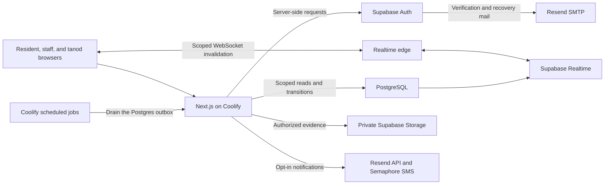

# Munti Report

Munti Report is a barangay service desk for filing and tracking local concerns. Residents submit reports, barangay staff triage and resolve them, and tanods receive field assignments and send updates. The application serves one barangay and uses the mobile-first workflows from the [design prototype](prototype/).

[Staging](https://muntireport.46.225.143.160.sslip.io) · [Screenshots and design evidence](.plan/mvp/evidence/README.md) · [MVP checklist](.plan/mvp/TODO.md)

> Staging is invite-only and intended for authorized testing, not live barangay reporting. Public enrollment, live SMS, and Lupon rollout have separate release gates.

## Portals

| Portal | What it does | Sign-in |
| --- | --- | --- |
| **Resident** (`/resident`) | File and track reports, upload private evidence, and follow case updates. | Email code for an approved address. |
| **Barangay** (`/barangay`) | Triage, assign, and resolve cases; manage incidents, duty rosters, and operational reports. | Invited work email, password, and authenticator app. |
| **Tanod** (`/tanod`) | See shifts and assignments, confirm arrival, and file field reports. | Pre-provisioned mobile number and SMS code when enabled. |

Administration lives at `/barangay/admin` and requires an administrator role. There are no shared staff credentials or prototype persona switches in the deployed app.

## Architecture

One Next.js deployment serves the three portals. Separate layouts and feature modules keep the workflows distinct. A single deployment shares the session, design system, localization, and release pipeline without synchronizing separate apps.



- **Access:** The server checks current membership and role. Staff access requires both password and verified MFA; PostgreSQL row-level security and Storage policies enforce record and evidence access.
- **Case updates:** PostgreSQL is the source of truth. Transactions persist changes, audit events, and pending deliveries together. Realtime tells authorized clients to refresh; it does not send report contents or photos.
- **Operations:** Auth, REST, Storage, and PostgreSQL stay on the private network. Notification jobs run separately from report submission, so a messaging failure does not undo a report.

See [Architecture decisions](.plan/mvp/ARCHITECTURE.md) for data boundaries, offline behavior, and the classification, prioritization, and hotspot methods. Classification suggestions are advisory; staff make the decisions.

## Tech stack

| Layer | Tools |
| --- | --- |
| Web | Next.js 16 App Router, React 19, TypeScript, Tailwind CSS 4, Radix/shadcn components, MapLibre GL |
| Data and identity | Self-hosted Supabase: PostgreSQL, GoTrue Auth, Storage, and Realtime |
| Messaging and abuse protection | Resend SMTP for auth mail; Resend API and Semaphore for optional notifications; Turnstile for public resident enrollment when enabled |
| Infrastructure | Docker standalone Next.js image, Coolify, GitHub Actions |
| Verification | ESLint, TypeScript, Vitest, pgTAP, and Playwright Chromium |

## Run locally

Prerequisites: Node.js **24.16 or newer**, npm, Docker, and the Supabase CLI (**2.113.0** is used in CI). Run these commands at the repository root:

```sh
npm --prefix apps/web ci
supabase start --exclude studio,postgres-meta,edge-runtime,imgproxy
node ops/with-local-supabase.mjs npm --prefix apps/web run dev
```

Open [the app](http://localhost:3100) and [Mailpit](http://localhost:56324). The wrapper connects the app to the local Supabase project and disables live messaging and maintenance jobs; you do not need Resend or Semaphore credentials for local work. The database starts without demo accounts. The [browser tests](apps/web/tests/e2e/) provision isolated synthetic users; use the [prototype](prototype/README.md) if you want a pre-populated walkthrough.

### Verify changes

```sh
npm --prefix apps/web run lint
npm --prefix apps/web run typecheck
npm --prefix apps/web run test
supabase test db
npm --prefix apps/web exec -- playwright install chromium
node ops/with-local-supabase.mjs npm --prefix apps/web run test:e2e
```

Start local Supabase before the database or browser checks. Keep port `3100` free for Playwright's test server, or set `TUGON_TEST_ORIGIN=http://localhost:3100` to use an app already started with the local wrapper. [CI](.github/workflows/verify.yml) also runs the browser suite against the standalone release image.

## Repository layout

| Path | Purpose |
| --- | --- |
| [`apps/web/`](apps/web/) | Next.js app, portal features, server actions, shared UI, and browser tests |
| [`supabase/`](supabase/) | Local stack configuration, migrations, row-level security, and SQL tests |
| [`ops/`](ops/) | Local runner, Coolify configuration, Auth templates, and operator utilities |
| [`prototype/`](prototype/) | Design and workflow reference with synthetic data; not shipped in the app image |
| [`.plan/mvp/`](.plan/mvp/) | Architecture, rollout checklist, design parity, operations, and verification evidence |

## Hosting and contribution

Coolify deploys the [standalone app image](apps/web/Dockerfile) separately from Supabase. Releases pin a tested commit and probe `/api/health/ready`. Follow the [operations runbook](.plan/mvp/OPERATIONS.md) for email delivery, rollout checks, and rollback. The [audited first-admin bootstrap](ops/supabase/bootstrap-admin.sql) is an operator-only procedure. Keep provider keys and database credentials in Coolify, never in Git.

For changes to a workflow, check the [design parity matrix](.plan/mvp/DESIGN-PARITY.md), use synthetic data, and include verification evidence in the pull request. Update the [MVP checklist](.plan/mvp/TODO.md) with the relevant result or remaining release gate.
